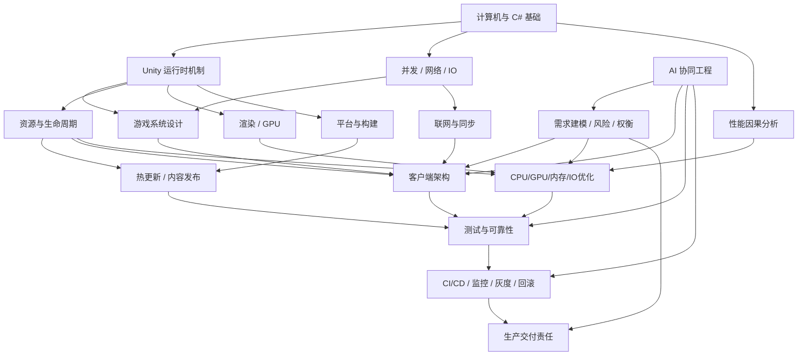

# AI 时代资深 Unity / C# 游戏客户端架构与性能优化工程师能力体系：研究报告草稿

## 执行摘要

本研究以用户给出的研究任务书为约束：研究对象不是“会多少 Unity API、框架或设计模式”，而是**一个工程师能否在复杂约束、信息不完整、性能与稳定性风险并存的商业项目中，独立完成问题建模、方案设计、验证、上线和失败恢复，并对长期结果负责**。因此，能力模型采用“知识 → 实践 → 判断 → 验证 → 责任”的链路，而不是技能关键词清单。fileciteturn0file0

研究的第一轮结论是：**真正区分普通功能开发者与资深客户端工程师的，不是代码生产速度，而是处理系统级不确定性的能力。** 对 Unity 商业游戏而言，资深工程师至少要能够回答五类问题：系统实际怎样运行；瓶颈或故障为什么发生；改变某一层会影响哪些其他层；怎样用数据证明修改有效；修改失败后怎样止损和恢复。Unity 官方的性能工具体系本身就体现了这种工程方法：Profiler、Memory Profiler、Profile Analyzer、Frame Debugger 和 Project Auditor 分别提供运行时测量、内存快照与差分、版本前后数据比较、渲染调用检查以及静态项目审计；官方也明确建议在**目标设备上的 Player Build** 中采样，因为 Editor 行为可能造成误导。citeturn208836search1turn208836search3turn208836search0

第二个结论是：**“架构能力”不是设计模式数量，而是控制复杂性和生命周期的能力。** Unity 的 PlayerLoop 是一个由多个子系统组成、每帧执行的主循环，而且允许读取和定制；Unity API 又大部分要求在主线程使用；资源、场景、异步操作、网络请求和对象销毁具有不同生命周期。由此推导，商业客户端中大量难查问题实际上不是局部算法错误，而是“生命周期错位”：对象已经销毁但异步任务继续执行、场景切换后旧回调修改新状态、资源引用计数未闭环、重连造成重复请求、热更新版本与本地缓存状态不一致等。citeturn208836search5turn999096search5turn999096search45

第三个结论是：**性能工程应被视作实验科学，而不是优化技巧集合。** Unity 官方资料强调先确认 CPU/GPU 是否超出帧预算，再定位瓶颈；实际案例中，Unity 与 Arm 通过 Profiler、Frame Debugger 和硬件工具定位到后处理、固定时间步、实例化、微三角形和 fragment overdraw 等具体瓶颈，优化后案例平均帧率由约 17 fps 提升到 28.9 fps。SYBO 在《Subway Surfers City》中则把 mesh/shader 复杂度预算、设备分级、动态分辨率以及持续真机 profiling 直接纳入生产流程。这说明资深性能工程师的核心行为不是“知道对象池/LOD/合批”，而是能构造**假设 → 测量 → 修改 → A/B 对比 → 回归验证**闭环。citeturn751766search7turn751766search8turn751766search0

第四个结论是：**资源管理、热更新和构建发布，本质上是“版本化分布式状态管理”问题。** Addressables 建立在 AssetBundle 之上；AssetBundle 的依赖关系会影响磁盘体积、重复资源与运行时内存；HybridCLR 则通过扩展 IL2CPP，使 AOT 运行时能够动态加载程序集，但同时需要处理代码裁剪、AOT 泛型、补充元数据和程序集兼容等问题。YooAsset 等成熟资源系统进一步把下载校验、断点续传、重试、版本回退和灰度纳入资源生命周期。因此，资深工程师需要把“能成功下载并加载资源”提升为“能保证版本一致性、完整性、失败恢复和可回滚”。citeturn999096search25turn999096search33turn892902search0turn892902search1turn892902search4

第五个结论是：**AI 会首先压缩“实现成本”，而不是自动消除工程责任。** 当前编码 Agent 已能完成相当比例的真实仓库任务；SWE-bench Verified 专门通过人工审核确保问题描述、测试和可解性，以减少基准噪声。与此同时，现实项目结果并不能由 benchmark 直接外推：METR 在 2025 年对 16 名熟悉大型成熟仓库的开发者进行 246 个真实任务的随机对照实验，发现当时的 AI 工具让这些开发者平均**多花约 19% 时间**，而参与者主观上却仍认为自己变快；研究者也明确警告不能把该结果推广到所有开发场景。citeturn460926search0turn460926search3turn460926search9

所以，AI 时代工程师的价值正在更明显地向以下能力集中，这是本研究基于现有证据作出的**综合推断**：**问题定义、系统建模、约束设计、因果诊断、权衡决策、验证设计、风险控制、生产责任和跨角色协调**。代码生成、样板重构、局部测试、文档初稿等工作会越来越适合自动化；但“到底应该改什么、怎样证明是对的、何时可以上线、失败后如何恢复”仍必须存在明确责任主体。长期运行 Agent 的公开实践同样强调增量执行、状态交接、可验证进展和避免“误判已经完成”，说明任务边界、上下文管理和验证闭环不是附属技能，而会成为 AI 协同工程本身的一部分。citeturn460926search6turn460926search7

**本研究暂定的资深工程师定义为：**

> 能在真实项目约束下，对跨模块系统建立正确模型；识别主要风险和瓶颈；设计可验证、可演进、可回退的方案；通过运行时数据和生产证据证明结果；并能让团队持续重复这一过程的人。

这一定义刻意不包含“工作多少年”“熟悉多少框架”或“代码写得多快”，与任务书要求保持一致。fileciteturn0file0

## 研究边界与证据框架

本报告优先覆盖 Unity 6 / 近五年官方资料，并在机制具有连续性的情况下引用较早 Unity 文档；Unity 官方 C# reference source 用于验证公开 API 和 PlayerLoop 等结构，但该仓库仅包含 Unity C# 引擎与编辑器参考源码，并不等于完整引擎 C++ 源码。citeturn208836search6turn208836search7

证据分为四档：

| 证据等级 | 定义 | 本报告使用方式 |
|---|---|---|
| **E1 强** | Unity / Microsoft 官方文档、源码、原始论文、可重复 benchmark | 可支持机制性事实 |
| **E2 较强** | GDC 一线团队技术分享、公开生产案例 | 支持“某类商业项目中确实发生过” |
| **E3 中等** | 成熟开源框架自身文档、厂商工程文章 | 支持工程方案存在及设计目标，不单独证明普遍优越性 |
| **E4 推断** | 基于多个 E1–E3 证据形成的工程判断 | 明确标记“推断”，不能冒充事实 |

特别地，HybridCLR、YooAsset 等项目自身的性能和能力描述属于项目方一手资料，因此可以确认其**设计、API 和工作机制**，但诸如“高性能”“低内存”等宣传性评价不能直接作为独立性能结论。citeturn892902search0turn892902search4

能力成熟度暂采用五级，后续章节会把每一级展开成评分量表：

| 等级 | 核心定义 | 最关键的可观察证据 |
|---|---|---|
| **L1 知晓** | 能解释基本概念 | 能正确描述机制，尚不能独立承担任务 |
| **L2 实现** | 能在明确需求下实现 | 功能正确、常规测试通过 |
| **L3 独立负责** | 能负责完整模块 | 能处理生命周期、异常、边界、性能和维护 |
| **L4 系统工程** | 能处理跨模块问题 | 能形成假设、设计实验、做技术取舍并证明结果 |
| **L5 技术领导** | 能让组织持续获得同类能力 | 建立预算、规范、工具、门禁、复盘和演进机制 |

这里的 L4/L5 刻意不定义为“写更复杂的代码”，而定义为**扩大可靠决策的作用范围**。这是本研究的框架性推断，与任务书要求的“可观察行为和工程结果，而非年限”一致。fileciteturn0file0

## 能力关系图

这张图表达一个重要判断：**性能优化和架构设计不是两个彼此独立的专业。** 架构决定数据布局、生命周期、依赖、调度和资源策略；这些因素直接影响 CPU、GC、IO、内存峰值以及渲染和网络成本。反过来，真实 profiling 数据又会迫使架构改变。因此，资深 Unity 架构/性能工程师最有价值的能力位于图中央的交汇处，而不是某一个 API 技巧。Unity 官方明确把 Profiler 定义为用于“决定需要优化什么”和“测试修改后性能”的工具，这正支持这种反馈闭环。citeturn208836search2

## 完整能力地图概要

下表是第一版能力地图。成熟度中的“目标”指**架构与性能优化方向资深工程师**的建议深度，而不是要求所有客户端工程师所有领域达到 L5。

AI 自动化分类遵循任务书定义：**A = 已可大量辅助/部分自动化；B = 可辅助但必须由工程师判断与验证；C = 必须存在明确责任主体的技术决策、风险控制或生产交付。** fileciteturn0file0

| 能力域 | 关键子能力 | 资深工程师的可观察行为指标 | 衡量/验收方法 | 目标成熟度 | AI 类别 | 证据与依据 |
|---|---|---|---|---:|---|---|
| **计算机基础与 C#** | 数据结构、复杂度、类型系统、泛型、委托、异常、内存模型、浮点、缓存意识 | 能解释“为什么这个方案在此负载下变慢/分配内存/产生竞态”，而不是只会改 API | microbenchmark；内存分配报告；复杂度分析；并发测试 | L4 | A/B | .NET 官方说明分配速率直接影响 GC 频率；ArrayPool 可降低频繁数组分配压力。citeturn384877search0turn384877search17 |
| **操作系统与并发** | 线程、锁、原子操作、内存可见性、任务调度、IO | 能选择 thread / job / async，而非把“异步”等同于“多线程”；能识别 race、deadlock 和数据所有权 | 压测；Thread/Timeline trace；故障注入 | L4 | B | Microsoft 建议多数共享状态优先使用 lock、Interlocked 等同步原语而非误用 volatile。citeturn384877search6turn384877search10 |
| **Unity 执行模型** | PlayerLoop、生命周期、执行顺序、Coroutine、Awaitable、时间系统 | 能画出一个功能从输入→更新→渲染/异步完成的时间线，并发现生命周期错位 | PlayerLoop 图；Profiler marker；场景切换/销毁测试 | L5 | B | PlayerLoop 是 Unity 每帧核心系统更新集合并可定制；Unity Awaitable 默认多数在主线程完成。citeturn208836search5turn999096search5 |
| **Unity 对象与内存模型** | managed/native 对象、GC、序列化、Destroy、引用关系 | 能区分托管堆增长、Native 内存、资源引用和真正泄漏；使用快照差分而不是凭 Task Manager 猜测 | Memory Profiler 多阶段快照；GC.Alloc trace | L5 | B | Unity Memory Profiler 可比较快照定位持续增长、泄漏及碎片；GC.Alloc 可追踪托管分配。citeturn208836search0turn208836search3 |
| **脚本后端与运行时** | Mono、IL2CPP、AOT、泛型、反射、代码裁剪 | 能提前识别 Editor/Mono 正常但 IL2CPP/AOT 失败的代码；设计 link.xml/保留策略 | IL2CPP 真机构建矩阵；strip regression | L4–L5 | B | IL2CPP 将 C# 和程序集转为 C++ 并 AOT 编译；UnityLinker 会进行 managed stripping。citeturn999096search0turn999096search15 |
| **游戏系统设计** | Entity、状态机、技能/Buff、事件、场景、UI、输入、配置驱动 | 能定义状态所有权、数据流、生命周期和错误恢复；避免“全局事件总线解决一切” | 架构图；状态转换测试；异常流程 review | L4–L5 | B | **E4 推断**：来自生命周期、并发、资源和网络约束的系统综合要求。 |
| **客户端架构** | 模块化、依赖方向、接口、插件、可测试性、可观测性、渐进重构 | 能明确哪些依赖允许、哪些禁止；能在不大爆炸重写的前提下演进旧项目 | ADR；依赖图；模块测试；迁移计划和回滚方案 | L5 | B/C | **E4 推断**：商业项目架构价值表现为控制变更半径、验证成本和失败成本，而非模式数量。 |
| **CPU 性能** | Main Thread、Render Thread、脚本热点、Jobs、同步点 | 先确认帧预算和瓶颈线程，再优化；能用 marker 和对比数据证明收益 | target-device Profiler；Profile Analyzer；P50/P95/P99 frame time | L5 | B | Unity 官方强调先测量 frame budget 与 CPU/GPU 瓶颈；Profiler 支持线程和脚本热点分析。citeturn751766search7turn208836search1 |
| **GPU / 渲染性能** | Draw Call、overdraw、shader、带宽、三角形、LOD、批处理、URP | 能判断 vertex/fragment/bandwidth/CPU submission 中谁是瓶颈；不同 GPU 采用不同策略 | Frame Debugger；GPU profiler；Arm/RenderDoc/Xcode/AGI | L4–L5 | B | Unity/Arm 案例通过硬件 profiling 定位 fragment bound、微三角形等问题；SYBO 使用 mesh/shader budget 与设备分级。citeturn751766search8turn751766search0 |
| **内存与 GC 性能** | allocation、heap、fragmentation、pooling、峰值、长时间运行 | 不追求机械“0 GC”；根据热点和设备内存预算判断优化收益与池化代价 | 快照、allocation call stack、长跑测试 | L5 | B | Unity incremental GC 将工作分摊到多帧但不减少总工作量；Memory Profiler 用于快照与碎片分析。citeturn999096search1turn208836search0 |
| **IO 与加载性能** | 文件读取、解压、反序列化、场景、shader warmup、首包 | 能把加载拆成磁盘/网络/解压/反序列化/实例化/GPU upload 各阶段 | startup trace；自定义 marker；冷/热缓存测试 | L4–L5 | B | AssetBundle 在运行时涉及 archive、metadata、cache 等不同内存成本；性能需按阶段定位。citeturn999096search12 |
| **资源管理** | AssetBundle、Addressables、依赖、引用计数、卸载、缓存 | 能解释“谁拥有资源、何时释放、依赖怎样闭环”；识别重复依赖和重复驻留 | bundle dependency graph；Memory Profiler；资源审计工具 | L5 | B | Addressables 建立在 AssetBundle 之上；重复依赖可能增加包体，并在同时加载时造成两份对象驻留。citeturn999096search25turn999096search33 |
| **资源构建与内容管线** | 导入规则、压缩、分包、确定性、版本 manifest、校验 | 将资源规范变成自动门禁而不是口头约定 | CI 资源扫描；build diff；bundle size regression | L4–L5 | A/B | Unity 提供 AssetBundle/Addressables 确定性比较与二进制检查机制。citeturn999096search43 |
| **热更新** | HybridCLR、AOT metadata、泛型、程序集版本、资源代码兼容 | 能设计客户端版本 × 热更 DLL × 资源版本的兼容矩阵；失败可降级/回滚 | 真机矩阵；断网/坏包/旧版本测试；回滚演练 | L5 | B/C | HybridCLR 扩展 IL2CPP 为 AOT+解释执行模型，并需处理 AOT 泛型与补充 metadata。citeturn892902search0turn892902search1 |
| **异步生命周期** | async/await、UniTask/Awaitable、CancellationToken、timeout、retry | 每个长任务都有 owner、取消条件、超时和异常路径；场景销毁后不会“幽灵完成” | chaos test：切场景/退出/断网/销毁时取消任务 | L5 | B | .NET 官方推荐通过 CancellationToken 传播取消；异常和取消必须作为 async API 的正式契约。citeturn384877search1turn384877search9 |
| **网络** | TCP/UDP、RPC、序列化、tick、弱网、重连、背压 | 能从 RTT、丢包、tick 和状态权威关系解释玩家体验问题 | 网络模拟；带宽统计；重放日志；弱网矩阵 | L4 | B | Unity Netcode 文档明确把 latency、packet loss、tick/update rate 和 interpolation 视为不同问题。citeturn892902search10 |
| **同步与预测** | 服务端权威、prediction、reconciliation、interpolation | 根据玩法选择一致性/响应性取舍，而不是套“预测”模板 | 100–300ms RTT + loss 仿真；状态偏差统计 | L4–L5专项 | B/C | NGO 的 client anticipation 是简化模型，不包含完整 rollback/replay，说明不同同步模型能力边界不同。citeturn892902search5 |
| **测试** | Unit/Edit/Play Mode、集成、性能、自动化、回归 | 不只测试 happy path；从风险反推测试矩阵 | mutation/fault injection；performance test；coverage by risk | L4–L5 | A/B | Unity 提供专门 Performance Testing API，可把性能指标纳入自动测试。citeturn208836search8 |
| **可靠性与崩溃分析** | crash、hang、ANR、泄漏、symbol、minidump、RCA | 能从线上现象构造复现条件、缩小变更范围，并把事故变成自动回归 | crash symbolication；复盘；新增 regression test | L5 | B/C | **E4 推断**：生产可靠性本质是诊断、恢复和防再发闭环。 |
| **平台适配** | Android/iOS/PC/WebGL、图形 API、权限、后台、thermal、memory pressure | 不把 Editor/高端 PC 结果外推到移动端；维护代表性设备矩阵 | 真机实验室；长时间 thermal test；platform CI | L4–L5 | B/C | Unity 官方建议 target device profiling；移动端 thermal throttling 会直接影响性能测量和持续帧率。citeturn208836search3turn751766search7 |
| **CI/CD 与构建** | 自动构建、多平台、签名、artifact、symbol、质量门禁 | 任意可发布版本可从版本库重复构建；失败能定位到 commit/asset/config | clean build；reproducibility；artifact provenance | L4–L5 | A/B/C | Unity Build Automation 支持版本库触发、多平台构建和自动 CI。citeturn892902search8turn892902search7 |
| **线上发布** | 灰度、监控、版本兼容、回滚、止损 | 发布方案同时包含 success path 与 rollback path；指标异常有停止条件 | game-day 演练；灰度规则；MTTR/rollback time | L5 | C | YooAsset 等资源方案把版本回退和灰度作为版本管理能力；更高层生产策略为本研究工程推断。citeturn892902search4 |
| **安全与数据完整性** | trust boundary、作弊、存档、协议、签名、经济系统 | 明确“客户端不可信”；关键奖励/经济结算不依赖客户端自证 | threat model；tamper/replay test；server validation | L4 | B/C | **E4 推断**：能力模型关注责任边界，不把混淆或加密误认为信任。 |
| **需求建模与决策** | 目标、约束、边界、验收、trade-off、ADR | 面对模糊需求先定义成功条件；能说明为何“不做某方案” | ADR；风险表；设计评审；验收标准 | L5 | B/C | **E4 推断**：这是系统工程层面的核心能力，也是任务书指定的重点。fileciteturn0file0 |
| **AI 协同工程** | decomposition、context、tool permission、review、verification、audit | 不用“AI 说测试通过”作为证据；把 AI 输出纳入编译、测试、真机和数据验证链 | AI change diff；test evidence；benchmark；审计记录 | L5 | A/B/C | Agent benchmark 已显示强代码能力，但现实生产率与 benchmark 不等价；长期 Agent 仍需要增量进度和状态交接机制。citeturn460926search0turn460926search3turn460926search6 |
| **沟通与技术领导** | 评审、文档、拆解、跨职能协作、技术债、风险沟通 | 把隐性经验变成团队可复用的预算、检查器、测试和规则 | adoption rate；事故率；review quality；bus factor | L5 | C | **E4 推断**：L5 的衡量单位从“个人完成任务”转向“团队持续正确完成任务”。 |

### 从地图中提炼出的“通用底座 + 核心深度 + 专项”

**所有资深客户端工程师的通用底座**应至少包括：C#/内存与并发基础、Unity 生命周期与 PlayerLoop、资源生命周期、异步正确性、基本 CPU/GPU/内存 profiling、模块边界、测试、构建、线上诊断、需求建模和风险判断。原因不是每个人都要成为底层专家，而是这些机制会直接决定任何商业客户端功能是否正确、可维护和可交付。Unity 官方文档反复表明 profiling 必须基于实际运行数据，而 IL2CPP、主线程约束、GC 和资源依赖又使“Editor 能跑”远不足以证明生产正确。citeturn208836search3turn999096search0turn999096search45

**架构与性能方向的核心深度**应放在：系统建模、生命周期、依赖控制、性能因果分析、资源/内存、异步调度、构建与发布可靠性。大型 Unity 实例也表明专项优化最终会回到系统设计：腾讯《重返帝国》的公开 GDC 分享不仅涉及 DOTS，而是数据抽象、任务并行、逻辑拆分、渲染和资源工具链共同作用；《原神》的 AI 系统分享同样把可扩展 AI 架构、NavMesh 磁盘/内存成本和多线程 CPU 任务结合讨论。citeturn751766search3turn751766search2

**按项目选择的专项深度**包括高级图形、强联网预测/ECS、超大世界 streaming、主机平台、底层 Native plugin、安全/反作弊等。一个纯 2D 卡牌项目没有必要要求客户端负责人达到 AAA 渲染专家深度；但他仍必须知道何时自己能力不足、该采集什么证据、怎样与专项专家协同。这一点属于能力模型的**规范性推断**，不是 Unity 官方规定。

## 普通开发者与资深工程师的初步分界

| 场景 | 普通功能开发者 | 资深工程师 |
|---|---|---|
| **需求** | 接到“做背包搜索”后直接实现 | 先明确规模、搜索频率、排序规则、数据来源、异步更新和验收指标 |
| **架构** | “用事件总线解耦” | 先问状态所有权、调用方向、生命周期、故障传播和可调试性 |
| **性能** | 看到卡顿就减少 Update / 加对象池 | 先获取目标设备 trace，判断 CPU/GPU/GC/IO，再建立可证伪假设 |
| **内存** | 看到内存高就调用 GC/UnloadUnusedAssets | 区分 Managed/Native/Graphics/Asset，并通过快照差分追踪 retention path |
| **异步** | `await LoadAsync()` 后继续访问对象 | 定义取消、超时、场景销毁、重复进入、异常和恢复语义 |
| **资源** | 能加载 Addressable 即认为完成 | 追踪依赖、引用、峰值、缓存、版本、失败下载和资源回滚 |
| **热更新** | DLL 能加载即完成 | 维护 AOT、裁剪、metadata、代码/资源版本兼容矩阵和 rollback |
| **网络** | “延迟高就做客户端预测” | 区分 authority、tick、RTT、interpolation、prediction 与作弊边界 |
| **测试** | 功能手测通过 | 依据失败模式构造边界矩阵、故障注入、回归与性能门禁 |
| **上线** | “本地和测试服都正常” | 定义灰度指标、停止条件、监控、旧版本兼容和 rollback |
| **AI 使用** | 让 AI 生成完整模块并看起来能跑 | 将任务拆小，约束接口和权限，要求代码+测试+数据证据，并独立复核关键路径 |
| **责任** | “我这段代码没问题” | 追问整个系统是否达到玩家体验、稳定性和业务目标 |

其中最重要的变化是：**资深工程师优化的是“决策正确率和系统失败成本”，普通开发者优化的通常只是“功能实现速度”。** 这是基于前述 Unity 生产案例、profiling 方法和 AI 软件工程研究形成的 E4 综合判断。Unity/Arm 的性能案例尤其能说明这种差别：团队没有根据经验直接猜答案，而是持续关闭变量、采集数据、验证瓶颈和再次测量。citeturn751766search8

## AI 自动化边界的第一版结论

AI 能力不能用一个固定百分比表示，因为同一个任务的自动化程度随代码库上下文、工具权限、测试可执行性和模型能力变化。更可靠的划分方式是按照**错误是否容易自动验证、错误代价多大、是否需要跨组织责任判断**来分类。这是基于 SWE-bench、SWE-Gym、METR 与长时 Agent 研究的综合推断。SWE-Gym 特别把可执行环境、单元测试和自然语言任务同时纳入训练/验证，也说明“可执行 verifier”对 Agent 软件工程能力非常重要。citeturn460926search2

| 类别 | 适合的 Unity/C# 工作 | 人类仍需做什么 |
|---|---|---|
| **A：高度可辅助/部分自动化** | 样板代码、序列化 DTO、Editor 小工具、简单测试生成、API 迁移、代码搜索、局部 refactor、文档初稿、静态规则生成、日志解析 | 给出明确输入输出；运行编译/测试；审 diff |
| **B：人机共同完成** | 模块重构、资源依赖治理、profiling 数据初步分析、异步链重构、网络协议改造、性能实验、测试矩阵、IL2CPP 兼容修复 | 定义目标和不变量；判断模型遗漏；设计真实环境验证 |
| **C：必须明确责任主体** | 架构边界、性能预算、上线批准、热更新策略、经济系统 trust boundary、灰度/回滚、跨平台支持范围、重大技术债取舍 | 承担风险判断和生产责任；决定何种证据足够 |

需要特别警惕“AI 输出非常流畅，所以工程风险降低”的错觉。已有安全研究发现 AI 代码生成存在生成不安全代码的风险；更近期的 GitHub 项目实证研究同样把 Copilot 生成代码的安全弱点作为独立质量问题研究。因此，即使 AI 生成代码能编译、局部测试能通过，也不能据此推断它满足安全、架构、生命周期或生产约束。citeturn460926search4turn460926search5

从职业能力角度看，这反而提高了三类能力的边际价值：**验收标准设计、系统级代码评审、真实环境验证。** 一个工程师若只能判断语法和局部实现，AI 越能大量生成代码，他面对的审核吞吐压力越大；能够利用 profiler、测试、静态分析、构建矩阵和生产指标形成机器可检查证据的人，才真正能放大 AI。这是当前证据支持下较强的 E4 推断，而不是关于“AI 永远无法替代工程师”的预测。

本阶段的总体结论可以压缩为一句话：

> **AI 时代资深游戏客户端工程师的核心，不再是比 AI 更快地写代码，而是比普通开发者更可靠地定义问题、建立系统模型、发现错误假设、设计验证机制、控制失败半径，并对生产结果负责。**

这也是后续完整成熟度模型、真实案例、成长路线、工程题库与个人评分卡应围绕的中心，而不是继续扩充技术名词清单。fileciteturn0file0