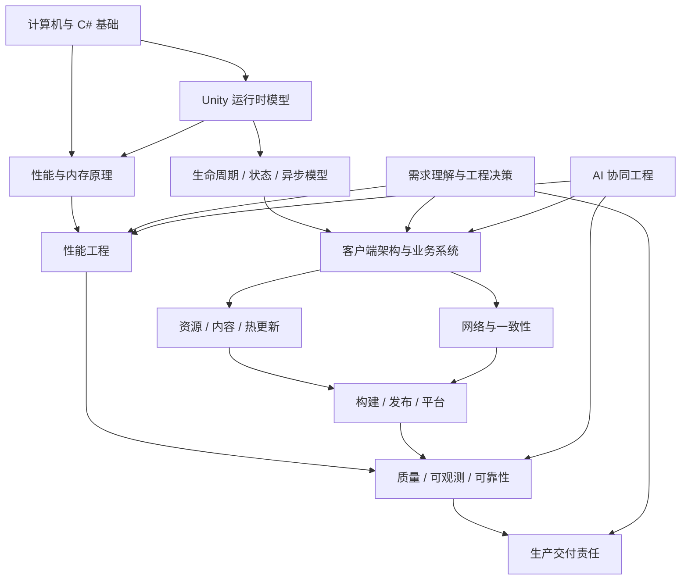

# AI 时代资深游戏客户端工程师能力体系：从“会写代码”到“对复杂系统负责”

## 执行摘要

本报告依据你提供的《深度研究任务书》开展，研究对象限定为 **Unity / C# 商业游戏客户端研发**，重点围绕架构、性能、资源与热更新、可靠性、生产交付和 AI 协同，而不是把“资深”定义为技术名词数量、工作年限或代码产量。原始任务书要求最终形成“通用底座 + 核心深度 + 按需专项”的能力结构，并且所有等级都必须由可观察的工程行为和结果证明。fileciteturn0file0

最核心的结论是：**资深工程师与熟练代码开发者之间的分界，并不是“能不能把功能写出来”，而是能否在不完整需求和复杂约束下建立正确的问题模型，选择可接受的方案，设计验证方法，并对上线后的结果和失败恢复负责。** Unity 官方自己的性能指导就体现了这种差异：优化不是套用“对象池、少 GC、少 Draw Call”之类的经验规则，而应先建立预算和基线、定位真正瓶颈、在目标设备上测量，再证明修改产生了预期收益。citeturn343306search3turn343306search4

因此，最关键的八项差异可以概括为：

| 普通功能开发者更常表现为 | 成熟资深工程师更常表现为 |
|---|---|
| 接到功能描述后立即进入实现 | 先提取目标、约束、边界、状态和验收证据 |
| 把模块理解成类和接口 | 把模块理解成状态、数据流、生命周期、资源所有权和失败路径 |
| 通过“代码能跑”判断完成 | 用功能测试、异常路径、目标设备数据和线上可观测性证明完成 |
| 遇到性能问题凭经验改代码 | 先测量、形成假设、隔离变量，再根据瓶颈优化；Unity 官方也明确建议如此 citeturn343306search3 |
| 遇到异步问题关注语法 | 关注任务所有者、取消、销毁、超时、重入、异常传播和恢复；Unity 甚至为 `MonoBehaviour` 暴露了 `destroyCancellationToken`，反映生命周期就是异步正确性的组成部分 citeturn489419search25turn489419search39 |
| 将框架选择等同架构能力 | 能解释为什么选择、替代方案、成本、适用边界和退出策略 |
| 将测试视为 QA 的职责 | 在设计时就规定如何证明正确性和如何防止回归；Unity Test Framework 同时支持 Edit/Play Mode 测试 citeturn570198search16turn570198search50 |
| 将“写完代码”视为责任终点 | 对发布、诊断、回滚、兼容、数据安全和长期维护成本负责 |

AI 时代强化了这种分界，而不是削弱它。到 2026 年，编码 Agent 已经可以阅读仓库、修改多个文件、运行命令和测试、创建 PR、执行自审，并进行较长时间的自主工作；OpenAI、GitHub 与 Google 的官方资料都显示，Agent 正从“补全代码”演变为具备上下文、工具调用、执行循环和审批机制的软件工程代理。citeturn860964search0turn860964search4turn860964search6turn860964search9 但这并不等于“工程判断已被解决”。SWE-bench Verified 本身就是在**问题清晰、代码库可访问、结果可自动评测**的条件下评价代码修改能力；MirrorCode 更进一步显示，当规格高度精确、存在强反馈信号时，AI 已能完成部分估计需人工数周的软件重实现任务，但研究团队明确警告这种环境与普通软件开发存在重要差异。citeturn893562search5turn893562search0turn893562academia7

现实生产环境中的研究反而显示了非常重要的条件效应。微软、Accenture 和一家 Fortune 100 企业的 4,867 人随机实验中，AI 编码辅助与完成任务数约 **26% 提升**相关，而且经验较少者收益更高；但 METR 对熟悉大型成熟开源项目的资深开发者所做随机实验发现，2025 年初工具反而使这些开发者平均 **慢约 19%**。两个结果并不互相否定：任务是否成熟、上下文是否隐含、验证成本、代码质量标准和开发者对代码库的先验知识都会改变 AI 的净收益。citeturn146807search4turn146807search11turn146807search0 DORA 2025 的近 5,000 人调查进一步指出，AI 更像“放大器”：强反馈、清晰工作流、良好测试和平台能力可以放大收益，而薄弱基础也会被放大；其数据同时观察到更高吞吐与较高交付不稳定性的关联。citeturn586091search0turn586091search2

所以，AI 时代最值得投资的并不是“手工敲代码速度”，而是六类能力：**问题界定、系统建模、因果诊断、工程取舍、验证体系、生产责任。** 这些能力未来很可能也会越来越多地被 AI 辅助，但只要最终系统仍有目标冲突、隐含约束、真实用户风险和责任归属，它们就是人类工程师最重要的能力杠杆，而不能简单等同于 Prompt 技巧。这个结论是基于当前证据的工程推断，而不是对 AI 永久能力边界的预测。citeturn893562search1turn586091search7

## 研究方法与证据质量

本研究采用“任务书问题分解 → 一手资料检索 → 独立研究交叉验证 → 商业案例验证 → 能力模型归纳”的方法。Unity/C# 机制以 Unity、Microsoft 官方文档为主要事实来源；YooAsset、HybridCLR 以项目官方文档和源码为主要来源；AI 能力部分同时使用厂商资料和独立研究，避免将产品宣传直接视为能力证据；工程案例优先选择公开的实际生产项目、官方技术文章及可复查指标。fileciteturn0file0

证据强度可分为四级。**一级**是官方 API/运行时文档和原始实验，例如 Unity PlayerLoop、Microsoft async 模型、METR 随机实验；它们适合支持“机制是什么”和“实验观察到了什么”。citeturn343306search0turn489419search2turn146807search11 **二级**是公开生产案例，例如 SYBO、Ubisoft、Jam City 的 Unity 项目复盘，适合证明“某类方法在特定商业项目中有效”，但不能外推为普遍最优。citeturn479259search0turn479259search2turn479259search4 **三级**是供应商产品数据，例如 GitHub Copilot、OpenAI Codex 功能和内部实验，可用于说明产品具备哪些能力，但涉及生产力效果时必须与独立研究交叉验证。citeturn146807search5turn860964search0 **四级**是本文根据多来源得到的能力模型、优先级和学习路线，这些属于综合判断，不应误认为行业标准。

AI 证据尤其需要防止三个误读。第一，SWE-bench 等代码 Agent 基准擅长测量**明确问题 + 自动判定**条件下的修改能力，并不等价于产品工程总体能力。citeturn893562search5turn146807search3 第二，MirrorCode 表明规格精确时长任务能力可以远高于传统短任务基准，但作者明确把“精确、可检查规格”列为重要限制。citeturn893562search1turn893562academia7 第三，主观“感觉更快”并不可靠：METR 的参与者在实际被测得变慢后仍主观认为 AI 让自己更快，这说明 AI 工程效益必须用周期、缺陷、回滚和性能等结果指标，而不能只看代码生成量或满意度。citeturn146807search0

## 完整能力地图

最合理的模型不是把所有领域平均学深，而是 **通用底座 × 核心深度 × 项目专项 × 交付闭环**。下图是本文综合后的依赖关系：

其中 **C# / Unity 原理是必要底座，但不是资深能力本身**。例如 Unity 的 PlayerLoop 是运行时各核心系统每帧更新的完整循环，而 MonoBehaviour 生命周期只是工程代码挂入其中的一组回调；真正理解它意味着能够判断“某代码在何时执行、依赖什么状态、是否可能重复或跨帧、对象销毁后发生什么”，而不是只记忆 `Awake/Start/Update` 顺序。citeturn343306search0turn343306search1

异步也是同样道理。Unity 6 的 `Awaitable` 可以切换主线程/后台线程并支持取消，但实例会被池化，因此不能像普通 `Task` 一样任意重复 await；Unity 的 API 又大量受主线程约束。citeturn489419search0turn489419search35 Microsoft 文档同时强调 Task 的异常传播、取消和同步阻塞风险。citeturn489419search1turn489419search3 所以资深工程能力不是“会 async/await”，而是能明确回答：**谁拥有这个任务？对象销毁后是否继续？超时怎么办？重复触发如何去重？部分成功如何回滚？异常在哪里被观察？**

性能应被视为独立的“科学实验能力”。Unity 官方流程要求在修改前建立 baseline、开发过程中持续 profile、修改后证明收益，而且目标设备的结果比 Editor 更可靠；CPU-bound、GPU-bound、内存压力、频率降档和热问题都可能产生相似的“卡”感。citeturn343306search3 因而资深性能工程师必须掌握“现象 → 指标 → 假设 → 实验 → 反证 → 修改 → 回归验证”，而不是背优化技巧。内存侧同理：Unity 的 GC 暂停可能造成尖峰，而增量 GC 本身也有运行时开销，因此“开启某设置”不能替代测量。citeturn343306search4turn343306search5

资源系统的关键能力也不是“会 Addressables / YooAsset API”。Unity 官方说明，Addressables 主要替项目管理依赖、位置和一部分生命周期，而 AssetBundle 仍然存在依赖、卸载和元数据成本。citeturn343306search6turn479259search6 YooAsset 的公开实现则进一步封装包、下载和资源调度；它是工程工具，而不是把资源所有权、版本兼容和失败恢复问题自动消失的魔法层。citeturn524241search10turn524241search8

热更新同样要求底层理解。HybridCLR 的核心机制是修改 IL2CPP 运行时，使纯 AOT 环境成为 AOT + Interpreter 的混合运行时；对于未在 AOT 侧实例化的泛型，需要预生成实例化引用或补充 AOT 元数据。citeturn524241search0turn524241search4 Unity 自身的代码裁剪又可能移除未发现的类型，使反射、AssetBundle 或 Addressables 中的类型在运行时缺失。citeturn343306search8turn570198search29 因此真正的“热更新能力”包含程序集边界、裁剪、元数据、资源版本、灰度、回滚与兼容矩阵，而不是“把 HybridCLR 接上”。

建议把能力分成下列层级：

| 能力层 | 必要程度 | 达到资深的判断标准 |
|---|---|---|
| C#、数据结构、内存、线程、数学 | 全员底座 | 能解释运行时后果，不只会语法 |
| Unity PlayerLoop、对象与资源生命周期、序列化、IL2CPP/AOT | 全员底座 | 能据此定位生命周期、裁剪和平台问题 citeturn343306search0turn343306search8 |
| 需求、状态、边界、失败路径建模 | 全员核心 | 能把模糊需求转换成可验证系统 |
| 架构与依赖治理 | 资深核心 | 能控制跨模块复杂性，并渐进演进 |
| CPU/GPU/内存/加载 profiling | 资深核心 | 以数据证明瓶颈和收益 citeturn343306search3 |
| 测试、诊断、发布、回滚 | 资深核心 | 修改进入生产前后都有证据闭环 citeturn570198search7turn570198search16 |
| 资源与热更新 | 商业手游常见核心 | 能处理版本、依赖、失败恢复，而非只调用框架 |
| 网络同步 / 图形 / ECS / 工具链 | 按项目专项 | 至少一项能达到系统级深度 |
| 安全与客户端信任边界 | 商业联网项目必需 | 明确客户端不能成为经济或权限真相来源；OWASP 和 Unity 网络文档都强调中心权威和信任边界 citeturn570198search14turn570198search23turn570198search39 |
| AI 协同 | 2026 年起的通用能力 | 能定义任务、权限、验证和审计，而非只会 Prompt |

## 能力成熟度模型

建议采用 **L1–L4 四级模型**，因为四级足够区分“会做”“能独立负责”“能系统性解决”“能塑造系统”，又不会把职业等级制造成虚假的精细数字。

| 等级 | 独立任务能力 | 思考方式 | 验证方式 | 可证明证据 | 常见能力假象 |
|---|---|---|---|---|---|
| **L1 实现者** | 在明确需求和已有模式下完成单模块功能 | “怎么实现” | 编译、手测、现成测试 | 可运行功能、局部 Bug 修复 | 看过很多框架＝掌握工程 |
| **L2 模块负责人** | 独立负责有生命周期、异步、状态和异常路径的模块 | “状态如何变化、哪里会失败” | 单元/集成/Play Mode、边界矩阵 | 模块设计文档、测试、故障复现 | 能写大型模块＝懂系统 |
| **L3 系统工程师** | 跨模块设计、性能诊断、资源/发布方案 | “约束、数据流、所有权、成本怎样相互影响” | 目标设备 profiling、故障注入、性能基线、回归门禁 | 性能报告、ADR、事故复盘、灰度/回滚方案 | 采用 ECS/DDD/Addressables＝架构高级 |
| **L4 技术负责人** | 推动架构演进、制定质量和生产标准，在不确定条件下做关键决策 | “什么问题值得解决，什么风险可以接受，系统如何长期演进” | 组织级指标、质量门禁、线上反馈闭环 | 跨团队技术决策、稳定性改善、复杂迁移成功案例 | 会评审别人代码＝具备系统领导力 |

等级的真正跃迁发生在“责任范围”而不是代码难度。例如一个 L2 可以写非常复杂的状态机，但如果无法判断它怎样与资源、场景切换、网络重连、版本升级和异常恢复共同作用，就还不是 L3。Unity 的真实系统行为本身支持这种判断：场景卸载会触发对象销毁，异步 continuation 又可能晚于销毁发生，因此跨生命周期正确性天然是系统问题。citeturn489419search42turn489419search25

**L3 的关键验收标准**应该是：面对“线上偶发卡顿”“场景切换后偶发 MissingReference”“低端 Android 运行 20 分钟后掉帧”“热更后部分玩家启动失败”等没有现成答案的问题，候选人能够提出多个可证伪假设、选择观测指标、构造最小实验、处理失败路径，并给出可回退修改。Unity 对 target-device profiling、Memory Profiler、Frame Debugger 和性能基线的建议本质上就是这一过程。citeturn343306search3turn343306search4

## AI 时代的人机能力分工

最实用的划分不是“AI 能不能做”，而是任务的**规格清晰度、验证可自动化程度、失败代价和责任成本**。

| 类别 | 典型工作 | 推荐做法 | 主要风险 |
|---|---|---|---|
| **A：高委托度** | 样板代码、重复 API 迁移、测试骨架、文档、简单重构、仓库搜索、生成检查脚本 | 给出明确范围与自动检查，让 Agent 自行修改和运行测试 | 过度修改、表面正确 |
| **B：AI + 人工程判断** | 跨模块重构、性能假设、资源迁移、复杂异步、网络流程、构建脚本、架构候选方案 | AI 生成候选与实验，人定义约束、review diff、跑真实测试 | 隐含需求遗漏、局部优化破坏系统 |
| **C：必须明确责任主体** | 经济系统权威、生产发布、数据迁移、热更回滚、隐私安全、性能 SLA、不可逆架构决策 | 人负责目标、风险接受和签字；AI 只能作为分析与实施工具 | 一次错误即可造成资产、收入或大量玩家影响 |

当前证据支持把很多“写代码”任务放入 A/B，而不是把软件工程整体放入 A。MirrorCode 已证明，在精确且可自动验证的目标上，AI 可以自主完成非常长的代码任务；这说明“代码量”“持续时间”“是否跨文件”已经不是可靠的人类护城河。citeturn893562academia7turn893562search1 与此同时，METR 的实地实验说明，在成熟代码库、隐含规范多、质量要求高的环境里，AI 带来的阅读、纠正和验证成本可能抵消生成速度。citeturn146807search0turn146807search11

这也解释了为什么“能编译、测试全绿”不等于工程正确。测试只能证明被编码进测试的条件；性能、设备差异、真实资源峰值和热状态需要特定环境才能暴露。Unity 明确建议在目标硬件而不是仅 Editor 上 profile，因为同一游戏可能在某设备 CPU-bound、另一台 GPU-bound。citeturn343306search3 同理，SWE-bench Verified 能证明 Agent 能解决大量具有测试 oracle 的仓库问题，却不能单独证明它理解了未写进 issue 或 test 的产品约束。citeturn893562search5turn146807search3

因此，真正的 AI 工程能力至少包含七个要素：**任务边界、上下文选择、权限最小化、小批次修改、可中断执行、独立验证、审计记录。** OpenAI 对 agent harness 的描述本身已把状态、工具、沙箱、审批和故障处理放在“模型 + Prompt”之外，说明长任务 Agent 的工程问题本质上是执行系统问题。citeturn860964search4 DORA 2025 的研究也将版本控制、小批次、可访问的内部上下文和质量平台列为 AI 产生正向效果的重要条件。citeturn586091search8

一个稳健的 AI 改动闭环应是：

## 真实案例与学习路线

**案例一：Subway Surfers City——性能工程不是技巧集合，而是瓶颈迭代。** SYBO 在早期只有约 16% 的目标设备能运行其图形复杂度，随后使用 Unity Profiler、Memory Profiler、Project Auditor、RenderDoc 和 Snapdragon Profiler逐层定位 GPU fragment、shader、CPU submission 与内存问题，并把性能预算放入发布门禁；公开案例称最终支持比例提升到约 95%。citeturn479259search2 一个很有工程价值的决策是：团队在测试矩阵中发现 Vulkan 在部分低端 Android 设备存在 render-thread stall 和 frame pacing 不稳定，因此选择 OpenGL，以稳定性和覆盖率优先于理论峰值性能。citeturn479259search2 这正是“资深判断”的典型：不是问“Vulkan 是否先进”，而是问“我们的约束下哪个方案有更高实际价值”。

**案例二：Jam City 的 Disney Magic Match 3D——性能预算必须包含热与长时间运行。** 项目早期在约 20 分钟会话中出现设备过热，团队把温度测量加入多机型测试，并找到碰撞调用、高面数模型、灯光等瓶颈；Unity 公布的结果包括低端 Android 帧率提升约 40 fps、RAM 降低、加载缩短等。citeturn479259search0 它说明“60 fps 一瞬间”不是完整性能指标，热降频、持续帧时间和长时内存状态才接近真实用户体验；Unity 官方 profiling 指南也专门提醒移动频率缩放会影响结果解释。citeturn343306search3

**案例三：Addressables——抽象层不能替代资源所有权设计。** Unity 的公开优化案例展示了一个常见陷阱：把直接引用改成 Addressables 可以延迟资源进入内存，但实例销毁后，纹理等依赖并不会自动按业务意图立即消失；Bundle 数量过多本身还会造成 SerializedFile 元数据成本。案例中调整 bundle 分组后，相关元数据从约 311 MB 降到 184 MB。citeturn479259search6 因此“会 Addressables”只是 L1/L2 能力；L3 要能推导依赖、引用计数、峰值、bundle 粒度和加载/卸载策略。

**案例四：League Client 重构——架构价值在于改变失败模式和团队边界。** Riot 重做 League 客户端时，并非单纯换技术栈，而是针对旧客户端资源占用、异步复杂度和状态管理问题，把 canonical state 下沉到基础层，使 UI 可以销毁后重新构造，并设计可独立交付的插件式功能边界。citeturn479259search8 虽然它不是 Unity 项目，但它很好地说明了客户端架构的核心问题：**状态由谁拥有、生命周期如何解耦、团队如何独立修改**，远比选择 MVC/MVVM/某框架名称重要。

基于这些证据，最有效的学习路线不是“课程 → 框架 → 更多框架”，而是五个递进阶段：

| 阶段 | 核心目标 | 必须交付的实践证据 |
|---|---|---|
| **运行时底座** | 真正理解 C#、PlayerLoop、GC、对象/资源、IL2CPP | 画出一个实际功能的生命周期图；用 profiler 证明一次 GC/主线程问题；解释一例 stripping 故障 citeturn343306search0turn343306search8 |
| **模块工程** | 状态、边界、异步、异常 | 完成带取消、超时、销毁和重试的场景加载/业务流程，并写故障测试 |
| **系统设计** | 跨模块依赖和资源所有权 | 做一个包含 UI、资源、配置、网络 mock 的真实系统，写 ADR 和依赖图 |
| **性能与生产** | 测量、基线、设备矩阵、发布 | 建立至少三档目标机性能预算，产出前后 profiler 数据和性能回归门禁 citeturn343306search3turn479259search2 |
| **AI 放大** | 让 Agent 在强约束和验证体系中工作 | 让 Agent 完成一次跨模块改动，保留任务定义、diff、测试、性能数据、人工 review 与复盘 |

时间有限时，学习优先级应是：**生命周期与状态 → profiling 与因果诊断 → 异步/失败路径 → 模块边界与依赖 → 测试/发布/回滚 → 一项专项深度 → AI 自动化。** 原因是前五项对几乎所有商业 Unity 项目都会产生复利，而 ECS、复杂 Shader、特定联网模型等更依赖项目类型。Unity 自身的 PlayerLoop、target-device profiling、Test Framework 和诊断能力也说明，这些底层和验证能力跨业务场景存在。citeturn343306search0turn343306search3turn570198search16turn570198search7

最容易制造“学了很多却解决不了问题”错觉的方式有四类：大量看架构文章却不维护真实系统；以“接入某框架”代替性能和失败场景验证；只做 happy path Demo；以及让 AI 一次生成大规模修改却没有基线、测试和 review。DORA 研究特别指出，大批次 AI 修改会增加审查和稳定性风险，因此小批次和快速反馈比单纯增加生成速度更重要。citeturn586091search7turn586091search8

## 实践验收、个人评估与最终结论

下面的题目不是面试知识题，而是可以直接作为成长验收项目。

| 实践题 | 输入 | 必须产出 | 评分重点 | 典型失败 |
|---|---|---|---|---|
| 模糊需求：跨场景任务系统 | 只有产品描述和几个 UI 草图 | 状态图、边界、异常矩阵、验收项、模块接口 | 是否主动发现歧义 | 直接开始写类 |
| 卡顿调查 | 一台低端 Android、随机掉帧 | baseline、Profiler 捕获、3 个假设、实验、最终证据 | 因果推理 | 上对象池后宣布优化 |
| 内存增长 | 反复进入场景内存持续涨 | Memory Profiler snapshot diff、引用链、修复前后数据 | 资源所有权 | 只调用 GC.Collect |
| 异步生命周期 | 场景加载、UI 销毁、网络请求并发 | cancellation/retry/timeout 设计和测试 | 取消、异常、竞态 | fire-and-forget |
| 热更新失败 | CDN 下载到 80% 中断或版本不兼容 | 状态机、完整性验证、重试、回滚、旧版本策略 | 恢复能力 | 只有“重新下载” |
| AI 跨模块重构 | 给 Agent 一个真实旧模块 | 约束文件、变更计划、diff、测试、性能结果、人工 review | 是否能找出隐含假设 | “测试绿所以合并” |
| 性能与工期冲突 | 2 周上线，低端机差 4 ms | 三个方案及收益/成本/风险、选择依据 | 取舍能力 | 追求理论最佳 |
| 线上事故 | 1% 玩家启动崩溃 | 最小止损、诊断数据、root cause、回归测试、预防措施 | 生产责任 | 修 Bug 不做复盘 |

个人自评也不建议使用“1–10 分”。应该记录**证据等级**：

| 能力 | 当前状态 | 合格证据 | 下一步 |
|---|---|---|---|
| Unity 生命周期 | 能解释 / 能实现 / 能诊断 | 实际生命周期 Bug 的复现与修复 | 构造场景切换 + async 竞态实验 |
| 性能 | 能解释 / 能测量 / 能优化 / 能防回归 | target-device 前后数据 | 建性能 CI/基线 |
| 资源 | 能加载 / 能设计 / 能处理失败 | 资源依赖与峰值报告 | 模拟损坏与版本回滚 |
| 架构 | 能画图 / 能实现 / 能演进 | ADR + 一次渐进迁移 | 量化复杂度或故障改善 |
| 测试可靠性 | 有测试 / 有异常矩阵 / 有门禁 | 自动化回归和事故防复发 | 故障注入 |
| AI 协同 | 会 Prompt / 会委托 / 会约束验证 | 一次可审计的 Agent 变更 | 加入权限与自动验收 |
| 生产责任 | 参与发布 / 能止损 / 能复盘 | 实际发布、回滚或事故报告 | 建 observability 闭环 |

最终可以给出一个比“技能树”更稳定的资深定义：

> **真正的资深游戏客户端工程师，是能够在复杂、不完整和存在风险的条件下，对客户端系统建立正确模型，设计合适边界，用实验和数据做决策，为异常和失败预先设计恢复路径，并用可审计证据证明系统可以进入生产的人。**

AI 正在快速降低“把明确规格翻译成代码”的成本；MirrorCode 和现代编码 Agent 已经表明，甚至大规模和长时间编码也不再天然要求人手完成。citeturn893562academia7turn860964search0 但同一时期的真实开发实验显示，**没有明确反馈、缺乏上下文或验证成本高时，更多自动生成不一定产生更多工程价值**。citeturn146807search0turn586091search7 因此，未来工程师的价值重心更可能从“自己写多少代码”继续迁移到“定义正确问题、创建可验证反馈、管理复杂性和承担交付责任”。这是当前证据支持度较高的方向性判断，但不是“AI 永远无法承担这些能力”的断言。

对于 Unity/C# 开发者，最必须亲自理解的是：**PlayerLoop 与对象生命周期、C# 内存和并发语义、资源所有权、异步取消和异常、IL2CPP/AOT/裁剪、CPU/GPU/内存测量方法、客户端与服务器信任边界**；这些知识决定你是否能判断 AI 或框架输出为什么正确。citeturn343306search0turn489419search1turn343306search8turn570198search28 API 记忆、样板代码、测试骨架、编辑器工具、批量迁移和大量常规实现则越来越适合 AI 辅助。

如果只能选最值得长期投资的能力，优先顺序应是：**系统建模 → 因果诊断 → 正确性与失败设计 → 工程取舍 → 可观测性与验证 → 生产责任。** 架构、性能、网络、图形、工具链这些专项，最终都是这些底层能力在不同约束下的应用。真正的成长证据也不应该是“读完多少文章”，而应该是：一个被你画清的数据流、一组可以复现的 profiler 数据、一个能从故障中恢复的状态机、一次带回滚方案的迁移、一份事故复盘，以及一个即使大部分代码由 AI 完成、你仍能证明其正确和安全的交付。citeturn343306search3turn479259search2turn586091search8

**报告版本：v1.0；研究日期：2026-10-29。** 当前最大研究缺口有三项：其一，公开资料中针对大型 Unity 商业项目的架构失效和事故复盘远少于性能案例；其二，2026 年编码 Agent 能力提升很快，半年以前的 benchmark 很可能迅速失效，因此“AI 可委托边界”应至少按季度复核；其三，HybridCLR、YooAsset 等中国商业 Unity 生态中存在大量实践知识，但公开的独立对照实验和失败数据仍然不足，所以对它们的评价应坚持“源码与项目需求优先、宣传指标次之”。AI 部分尤其应持续跟踪真实生产 RCT、长任务 benchmark 和交付稳定性数据，而不是只追踪模型榜单。citeturn146807search1turn893562search3turn524241search0turn524241search10