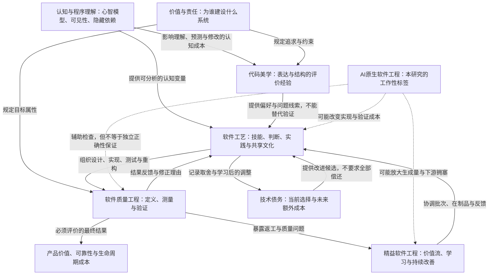
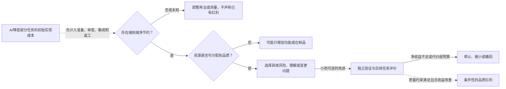

# 概念与理论关系图

> [!WARNING]
> 公开研究草案：Batch01-B仍为PARTIAL，人工研究审核pending，代码／参与者实验未执行。公开提交授权不等于研究通过。
> 文内“未发布”、本地文件名、行号和检查点属于原研究时点；本页已作公开目录与链接适配，不是字节保真档案。当前阅读顺序与发布边界见[课题入口](../README.md)。

> [!WARNING] 图示不是因果发现
> 图、矩阵及变量选择都是本研究的综合组织工具。Batch01-A 已读取部分核心全文，实际状态见 [sources](../evidence/sources.md)。实线表示概念／实践上的联系，**不是已证实因果**；虚线表示待检验机制。

## 1. 概念关系：同一个系统，不同问题

“AI原生软件工程”在这里仅指把AI参与纳入任务、上下文、验证、责任与反馈设计；不主张其已有统一成熟定义，也不定义为“把人移出所有环节”。

**文本替代**：价值决定目标；美学提供评价线索；工艺组织实践；质量工程提供属性与证据；精益协调全过程；技术债连接时间尺度；AI改变成本与工作分配，但最终仍应考察产品结果。

## 2. 理论对照矩阵

| 视角 | 主要分析对象 | 核心问题 | 可用证据／材料 | 常见混淆 | 原始入口 |
|---|---|---|---|---|---|
| 代码美学 | 人对代码表达与结构的评价 | 为什么感觉清楚、优雅或别扭？共识怎样形成？ | 访谈、观察、评分、真实理解任务 | 把偏好当正确性、把熟悉度当普遍美 | A01、A02、Q11 |
| 认知与程序理解 | 人如何建立程序模型、领域模型和记法心智模型 | 什么结构降低查找、推理和修改负担？ | 受控理解任务、think-aloud、错误率、查找与修改轨迹 | 把认知维度直接加总成美学分数 | K01—K03 |
| 软件工艺 | 个人与团队的专业实践 | 如何形成和执行好判断，持续学习？ | 纵向案例、文献分类、宣言与实践材料 | 把运动宣言当实证；把资历当正确性 | A03、A05、A07 |
| 软件质量工程 | 产品属性与验证过程 | 在何种条件下达到哪些要求？ | 标准、测试、观测、实验、故障数据 | 把静态指标当质量本身 | Q02、Q08、C01 |
| 精益软件工程 | 从需求到可用结果的价值流 | 哪里等待、返工、信息未反馈？ | 流程观测、受控改进、组织案例 | 把局部利用率、裁员当精益 | L01—L05、L07/L08 |
| 技术债务 | 当前选择与未来负担 | 何时偿还、接受、延后或废弃？ | 变更历史、因果分析、成本估计、决策记录 | 所有旧代码都是债；债必全部偿还 | Q06、Q09、Q01 |
| AI参与工程 | 人机分工与成本结构 | 哪些任务净节约，谁承担验证？ | 限定工具／任务的随机或现场实验 | 生成快=交付好；基准通过=产品可靠 | I01—I04 |

## 3. 概念边界矩阵

下表为本研究工作定义，不声称是某个标准的逐字摘录。

| 术语 | 不等同于 | 更合适的评价方式 | 关键反例 |
|---|---|---|---|
| 美 | 整齐、正确、便宜 | 明确群体的评价＋实际任务结果 | 众人偏好的写法可能隐藏错误 |
| 简洁 | 最少行数 | 必要概念、状态、依赖、前提的负担 | 一行表达式需要同时理解多种副作用 |
| 清晰 | 代码熟悉 | 能否正确预测行为、定位原因 | 熟悉的框架习惯也会误导 |
| 抽象 | 接口／类更多 | 是否隔离真实变化、减少局部推理负担 | 猜错变化点的通用框架 |
| 可维护 | 静态检查得分高 | 实际理解、变更和验证任务 | 为消除告警添加更多间接层 |
| 可演进 | 容易修改一行 | 新需求下能否保持约束并合理改变 | 局部好改但系统契约全面破坏 |
| 可靠 | 测试全绿 | 特定环境与时期下的可靠性证据 | 测试缺少并发、时间和故障条件 |
| 重构 | 任意重写／功能升级 | 行为保持证据与结构收益 | 功能和结构同时大改，无法归因 |
| 精益 | 极限减人／满负荷 | 价值、周期、队列、质量、负荷联评 | 开发持续产出、审查长期拥塞 |
| 生产力 | 生成量／LOC | 同等质量约束下的可用结果与总成本 | 代码更多但返工更久 |

## 4. 制造业向软件工程迁移矩阵

> 全部“软件迁移”均为待验证机制；没有本轮实测数。原理解释与软件效果证据不能互相替代。

| 原思想／机制 | 软件迁移假设 | 成立条件 | 不能机械迁移之处 | 失败信号 | 建议观测变量 |
|---|---|---|---|---|---|
| Jidoka（L03） | 自动／人工检查发现异常后停止进入后续环节 | 信号有效、处置人明确、有停止权、可定位修复 | 不是自动化越多越好；测试不能覆盖未知需求 | 误报疲劳、绕过红灯、生产缺陷无下降 | 发现至止损时间、逃逸缺陷、恢复时间、检查成本 |
| JIT与拉动（L03） | 根据审查／集成能力启动工作，缩小批次 | 工作可切分、依赖可见、合理缓冲 | 软件需求可变，不能等同零库存或满利用率 | 待审PR增长、阻塞时间增加、无意义拆票 | WIP、端到端周期分位数、批次、返工 |
| Kaizen（L03，独立原典缺口） | 从真实问题开始的小规模改进和复测 | 有改进预算、表达问题安全、能撤销 | 不是不断增加规范、工具或考核 | 活动次数上升但故障复发不变 | 重复故障、负荷、变化前后任务结果 |
| PDSA（L04） | 事前预测、实施、研究偏差、决定下一步 | 结果可观察、保留负结果、记录干扰 | 不是Check完成项就算学到知识 | 事后选择指标、只有成功故事 | 预测与观察差异、复现、撤回与改判记录 |
| TQM（L05） | 跨角色对用户品质结果共同负责 | 目标一致、管理参与、数据与反馈可用 | 不把质量外包给测试部门或认证文件 | 开发效率改善靠测试／运维吸收损失 | 用户故障、跨部门等待、全周期成本、负荷 |
| 精益产品开发（L06/L09） | 通过试验与知识积累减少错误承诺 | 关键不确定性明确、试验可比较、收敛点存在 | 探索与备选方案不必是浪费 | 取消探索导致晚期返工，或无限研究不决策 | 不确定性消除、晚期变更、试验成本、交付时间 |
| 软件精益（L02/L01） | 将价值、学习、集成和质量内建共同组织 | 可反馈需求、技术可验证、激励一致 | 不是照搬装配线动作和统一节拍 | 小票很多而实际可用成果少 | 从需求到可用结果、变更失败、维护成本 |
| 标准化（综合提案） | 规范稳定接口、机械检查与共同最低底线 | 明确适用范围、例外通道、可修订 | 不能标准化所有设计判断 | 规则通过但问题未解决，新手只会迎合规则 | 误报、例外、争议解决时间、真实任务错误 |

## 5. 成本转换的机制图

**文本替代**：生成节约只是入口。没有端到端节约，就没有被证明的可再分配红利；有节约但组织不分配，也不会自动升级品质；投入后还需验证净收益。安全义务无论是否有节约都存在，图不表示可以不满足强制约束。

## 6. 从关系到可反驳预测

| 机制假设 | 支持信号 | 反对／削弱信号 | 不足以证明的指标 |
|---|---|---|---|
| 清晰结构减少理解负担 | 同等任务更少误解、更快正确修改 | 偏好上升但任务无改善或变差 | LOC下降、审查者说漂亮 |
| 适当信息隐藏改善演进 | 后续变化局部化且验证成本下降 | 需要更多跨层修改、约定和回归修补 | 类数量、接口数量 |
| 限制在制品缩短反馈 | 周期与等待下降，质量未劣化 | 只让工作移出可见队列 | 开发者利用率、提交数量 |
| AI节约可转成质量 | 全周期成本下降且质量属性改善 | 生成快、审查和逃逸缺陷增长 | token数、代码产量、接受建议率 |

## 7. 图示验证边界

采用文本标签和Mermaid默认主题，不用定制类别配色或颜色强弱表达证据；矩阵和文本替代保证不依赖图形。已做源文本围栏、节点引用等结构检查的记录见 [review](../audit/review.md)。**没有安装渲染依赖，没有运行Mermaid渲染器，也未在Obsidian阅读视图实测**；不声称视觉验收已通过。

返回 [00_研究包说明与阅读导航](../README.md)；相关 [04_代码优美论初步理论框架](framework.md)。

## 8. Batch01-A 新增认知层

认知层不是代码美学的同义词，而是解释代码表达如何影响人类理解与修改的机制层。K01 支持熟悉的程序计划和表达惯例影响理解；K02 提供可见性、黏滞性、隐藏依赖、角色表达性等分析维度；K03 的原始章节未取得，只能作为二手摘要线索。完整分析见 [08_认知科学与程序理解补充研究](cognition.md)。

**图示边界：** 认知维度可帮助提出可检验变量，但不能直接求和形成“优美代码分数”。同一结构对专家、新手、领域熟悉者和陌生维护者的效果可能不同。
