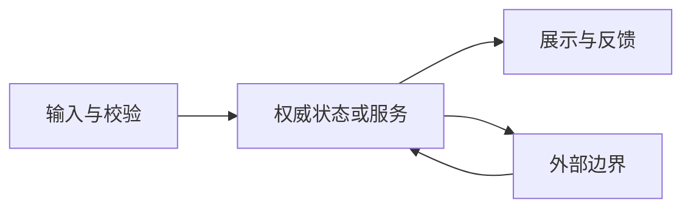
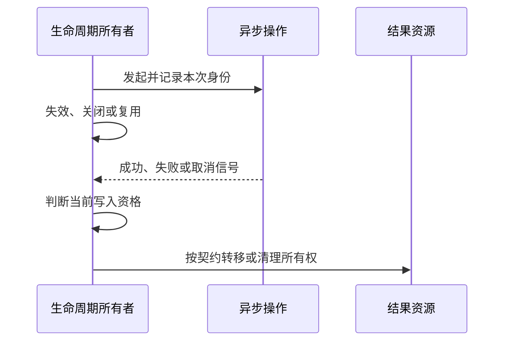

# 工程判断实践模板包

> **公开导出注（2026-11-12）**：以下研究状态、访问和审查记录属于原 2026-11-06 草案；本次只作本地白名单导出。公开授权不等于人工研究审核、实验通过或生产验收。私有状态描述是历史记录；模板及操作文本仅作资料，不在本次执行。转换与排除见 [导出清单](export-manifest.json)。

导航：[工程判断模型与决策手册](decision-handbook.md) · [成熟项目源码阅读与设计还原手册](source-reading-handbook.md) · [工程判断力训练与能力评估手册](training-and-assessment-handbook.md) · [AI时代工程判断与人机协作手册](human-ai-collaboration-handbook.md)

> **tip** — 使用方法
> 以下是空白工作模板，不是已执行记录。`待填写/未知/未运行/N/A（原因）` 都是合法状态；不要为凑完整而写“已验证”。Tier 1 只用模板 1 的四问与必要验证；Tier 2 组合 1、5、8、9；Tier 3 才展开 6、7、12、13。统一从 [sources](sources.md) 引用外部来源，不另造一套编号。

## 1. 需求理解卡

- 任务/日期/负责人：
- **要改变的可观察行为**：
- 不变的行为/非目标：
- 使用者与权威来源（谁确认需求）：
- 目标版本/平台/包/后端/内容版本：
- 触发、输入、输出、成功与失败条件：
- 硬约束与可协商约束：
- 已确认事实 / 关键假设 / 待问问题：
- 风险 Tier 与理由：
- 验收 oracle（不依赖实现自述）：
- 停止/升级触发器：

**Tier 1 四问短卡**：改什么？为何在这里改？可能坏什么？如何知道没坏？

## 2. 项目探索记录

- 本次要作出的决定：
- 仓库/tag/SHA、工作树改动状态：
- 启动/构建/测试入口及是否实际执行：
- Editor/包/平台/编译后端/生成步骤：
- 首条纵向路径：
- 与本任务相关的两个范例与一个例外：
- 不可违反的契约：依据是什么？代码/工具门禁/维护者？
- 未探索区域及为何暂不需要：

| 问题 | 文件/符号或运行证据 | 已知/推断/未知 | 影响哪个决定 | 下一次最小核查 |
|---|---|---|---|---|
| 待填 | 待填 | 未知 | 待填 | 待填 |

## 3. 系统/模块地图

| 模块/边界 | 职责与非职责 | 输入/输出 | 状态权威/owner | 外部依赖 | 失败/恢复 | 证据 |
|---|---|---|---|---|---|---|
| 待填 | 待填 | 待填 | 待确认 | 待填 | 待填 | 未核验 |

| 依赖边 | 直接/事件/内容/动态注册 | 契约 | 已确认还是推断 | 哪种变化会沿边传播 |
|---|---|---|---|---|
| 待填 | 待填 | 待确认 | 未知 | 待填 |

地图不是全仓库目录清单；标出版本和本次任务范围。

## 4. 数据流与生命周期图模板

下面是**概念图模板**，不编码数值或风险颜色；没有项目事实。纯文本/表格与图表达相同信息，不能把箭头当时序证明。未在 Obsidian 阅读视图渲染核验。

替换节点后，为每条边补：数据类型、触发时机、同步/异步、线程/PlayerLoop、失败与重试、版本契约、事实依据。

图的文字替代：owner 发起操作；owner 可能先失效；结果回来后必须依据真实契约决定能否应用以及谁清理。**取消等待不自动等于底层中止或资源释放。**这是检查问题，不是所有 API 的统一契约。

| 对象/操作/结果 | 创建者 | 当前 owner | 写入资格失效点 | 取消语义 | 成功/失败/晚到清理 | 池复用/重复清理检查 |
|---|---|---|---|---|---|---|
| 待填 | 待填 | 待确认 | 待确认 | 待核 API | 待填 | 未运行 |

## 5. 方案比较表

- 共同目标与不变约束：
- 真实备选（包含保持现状/不做是否可行）：
- 决定性质量场景：

| 方案 | 硬门槛是否满足 | 交付/维护代价 | 生命周期/兼容风险 | 证据及不确定性 | 何时改选 |
|---|---|---|---|---|---|
| A | 待核 | 待估 | 待填 | 未核验 | 待填 |
| B | 待核 | 待估 | 待填 | 未核验 | 待填 |

- 选择与理由：
- 若权重/需求/平台变化，选择是否反转：
- 下一条信息会不会改变选择：
- 不使用加权总分的理由 / 使用时量纲和敏感性说明：

## 6. 风险登记表

| 风险情景（原因→事件→损害） | 后果/影响对象 | 证据与未知 | 预防/检测 | 隔离/恢复及恢复不了的损害 | owner | 残余风险接受/升级 |
|---|---|---|---|---|---|---|
| 待填 | 待填 | 未核验 | 待设计 | 待确认 | 未指定 | 未接受 |

- 是否存在共同失效、关联依赖或观察盲区：
- 最坏情况是否触发硬门槛：
- 不把序数风险相乘作为精确概率；未知不自动记“低”。

## 7. ADR

- ID/标题/日期/状态：proposed / accepted / superseded / rejected（如实填）
- 决策负责人、审阅者与授权范围：
- **上下文**：问题、版本、关键质量场景、硬约束。
- **已知证据**：路径/测试/运行记录/来源 ID。
- **假设与不确定性**：什么未知会影响决定？
- **备选**：保持现状、局部方案、结构性方案；仅列真实可行者。
- **决定**：选什么，不做什么。
- **理由**：收益、代价、为什么现在足够。
- **后果**：正面、负面、维护/内容/发布影响。
- **验证与恢复**：oracle、门槛、分阶段、可恢复与不可恢复部分。
- **复查触发器**：负载、需求、版本、故障或维护成本变化。
- **替代关系**：替代哪份 ADR？不静默改写历史。
- **实际结果**：实施后补充，不倒写为事前已知。

## 8. Change Impact Analysis

- 起点：需求/配置/协议/代码/资产变化是什么？
- 变更前不变量与预期变化：

| 影响域 | 直接影响 | 间接/时序/版本传播 | owner/调用方 | 兼容与回归证据 | 未核验项 |
|---|---|---|---|---|---|
| 代码/API/模块 | 待填 | 待填 | 待确认 | 未运行 | 待填 |
| prefab/scene/序列化 | 待填 | 待填 | 待确认 | 未运行 | 待填 |
| 配置/表格/资源 key | 待填 | 待填 | 待确认 | 未运行 | 待填 |
| 资源加载/池/内存 | 待填 | 待填 | 待确认 | 未运行 | 待填 |
| 协议/服务端/重连 | 待填 | 待填 | 待确认 | 未运行 | 待填 |
| 存档/持久化/经济 | 待填 | 待填 | 待确认 | 未运行 | 待填 |
| 热更新/AOT/裁剪 | 待填 | 待填 | 待确认 | 未运行 | 待填 |
| 平台/构建/发布顺序 | 待填 | 待填 | 待确认 | 未运行 | 待填 |

不适用行写 N/A 与理由；搜不到引用不等于无依赖。明确边界之外是谁继续检查。

## 9. 验证矩阵与验收记录

| 需求/风险/不变量 | 独立 oracle | 方法/环境/版本 | 输入与时序 | 预期结果 | 实际结果/原始记录 | 状态与限制 |
|---|---|---|---|---|---|---|
| 待填 | 待确认 | 待填 | 待填 | 事前填写 | 尚无 | not-run |

- 正常、边界、失败、取消、重复、乱序、失效/销毁/复用：按适用性选。
- Editor/PlayMode/目标设备/构建后端/新旧内容与协议：按风险选择，说明遗漏。
- 结果状态：pass / fail / blocked / not-run；命令与退出码、日志/capture 路径留在记录。
- 测试证明了什么 / 没证明什么：
- 发布前风险接受人/日期：未批准。
- 停止条件：目标达标、关键回归满足、剩余未知有明确处理；不是“覆盖率够高”。

## 10. Code Review 判断表

| 检查项 | 判断问题 | 证据/失败场景 | 结论与最小建议 |
|---|---|---|---|
| 需求 | 是否解决正确问题、有未授权行为变化？ | 待填 | 待填 |
| 契约 | 权威、输入、错误/取消语义是否一致？ | 待填 | 待填 |
| owner | 创建/订阅/取消/释放是否成对？ | 待填 | 待填 |
| 状态 | 重复/乱序/重入/关闭后回调如何处理？ | 待填 | 待填 |
| 影响 | 内容、协议、存档、兼容受影响吗？ | 待填 | 待填 |
| 复杂度 | 抽象解决真实变化还是个人偏好？ | 待填 | 待填 |
| 验证 | 测试是否可能与实现共享同一错误？ | 待填 | 待填 |
| 交付 | 范围、回退、已知限制是否清楚？ | 待填 | 待填 |

缺陷条目格式：**具体输入/状态 → 代码路径 → 错误结果 → 证据 → 重要性 → 最小修复/验证**。风格偏好单列，不伪装成正确性缺陷。未复现标推断，不能写“已确认”。

## 11. Debug 假设与证据记录

- 症状/用户影响/首次出现版本：
- 最小复现与不能复现的环境：
- 已知好/坏版本、最近改动、时序及日志关联 ID：

| 假设 | 若成立应看到什么 | 若不成立应看到什么 | 最小区分实验 | 实际观测 | 保留/削弱/排除及原因 |
|---|---|---|---|---|---|
| H1 | 事前写 | 事前写 | 待设计 | 未运行 | 未决定 |
| H2 | 事前写 | 事前写 | 待设计 | 未运行 | 未决定 |
| H3 | 事前写 | 事前写 | 待设计 | 未运行 | 未决定 |

- 控制变量、并发/缓存/时间等混淆：
- 修复是否作用于因果机制，而不仅隐藏症状：
- 回归 oracle 与未解决问题：
- 若实验有副作用，如何在隔离环境进行：

## 12. Postmortem

- 事件/时间/版本/参与角色/资料保密范围：
- 玩家/业务影响（已知与未知分开）：
- 事实时间线（时区、数据源）：
- 发现→缓解→恢复→确认，各自的证据：
- 促成条件：需求、设计、代码、内容、部署、观察、组织授权。
- 哪些防线有效？哪些失败或缺失？
- 当时可得信息与今天新增信息分别是什么？
- 竞争解释与尚未确定的原因：
- 不能只以“加强责任心/更加仔细”作为改进。

| 改进行动 | 对应失败机制 | owner/授权 | 验证行动有效的方法 | 截止/复查 | 副作用/负担 |
|---|---|---|---|---|---|
| 待设计 | 待填 | 未指定 | 待设计 | 待定 | 待评估 |

复盘记录不授权披露私有信息，也不替代安全/法律调查。

## 13. AI 委派与输出验收表

### 委派合同

- 任务目标/非目标、固定版本：
- 可访问/可写路径；禁止访问数据：
- 先读入口、相邻范例、测试/规范：
- 允许工具、网络、执行命令；禁止发布/依赖安装/配置改动：
- 人类事前判断：owner、最小方案、主要风险、验收：
- AI 输出要求：事实/假设分开、文件符号证据、最小 diff、实际运行结果和未完成项：
- 停止/升级条件：

### 验收

- [ ] 改动文件均在授权范围，没有读取/输出凭据与私有内容。
- [ ] API 与对应版本真实存在，没有把新版本能力当旧版本事实。
- [ ] 契约、状态权威、所有权、异常/取消/释放符合项目约定。
- [ ] 需求与测试 oracle 在实现之外独立确定。
- [ ] 检查过“实现与新测试共同误解需求”的可能。
- [ ] 有独立边界/回归或运行证据，状态真实记录。
- [ ] 原有测试/门禁没有为通过而被静默削弱。
- [ ] 能解释失败模式、未测环境、恢复及残余风险。
- [ ] 没有顺手公共重构、无关格式化或新增未经批准依赖。
- [ ] 人类批准发布/风险接受；AI 的“完成”不是批准。

## 14. 个人能力复盘表

- 任务/能力域/指导程度/是否使用 AI：
- 事前预测（可判定事件、置信度、何时判定）：
- 实际结果与独立证据：
- 判断对/错/暂不能判定，各自理由：
- 哪条证据改变了判断？
- 是领域知识缺口、系统模型错误、证据不足，还是验证失败？
- 有何结果偏差/确认偏差/错误类比/自动化偏差？
- 更新后的**条件规则**：当…且…时…；因为…；除非…；下一次用…验证。
- 下次无 AI 或陌生模块的变式任务：
- 流程负担：哪些记录没帮助，下次删什么？

## 15. 源码案例卡（扩展工具）

项目/许可证/版本；具体问题；阅读前预测；路径/符号；当前行为；作者意图证据；研究者推断；真实替代；收益代价；边界；迁移/不迁移；练习；oracle；实际验证；未核验项。

## 16. 每周最小工作系统

**一张任务卡 + 现有代码/测试/运行证据 + 一条条件规则。**

高风险时才展开更多模板。模板缺字段不是唯一问题：如果没有真实决定要作、没有任何信息会改变它、也不会回来验证，那么写再完整也不是判断训练。
